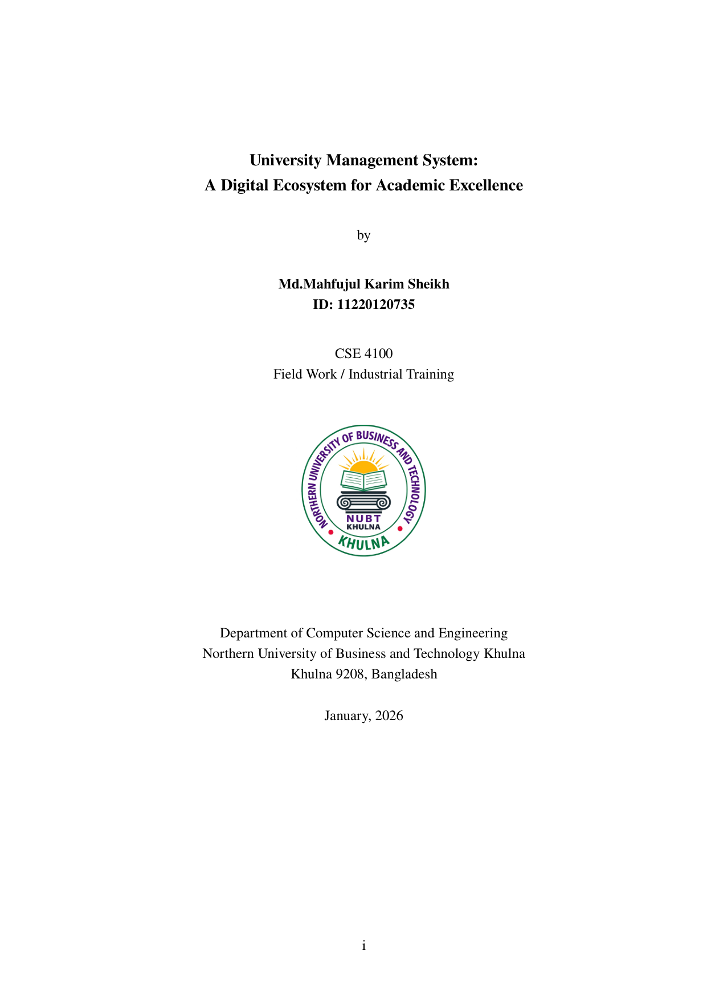
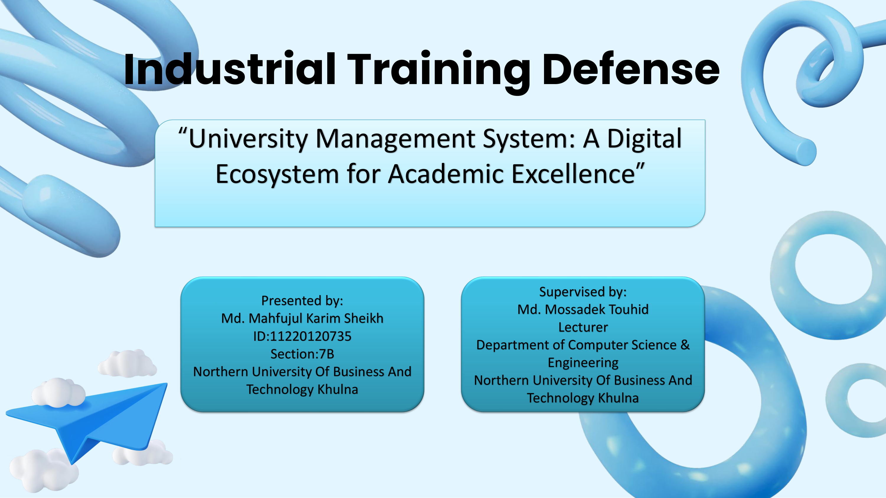
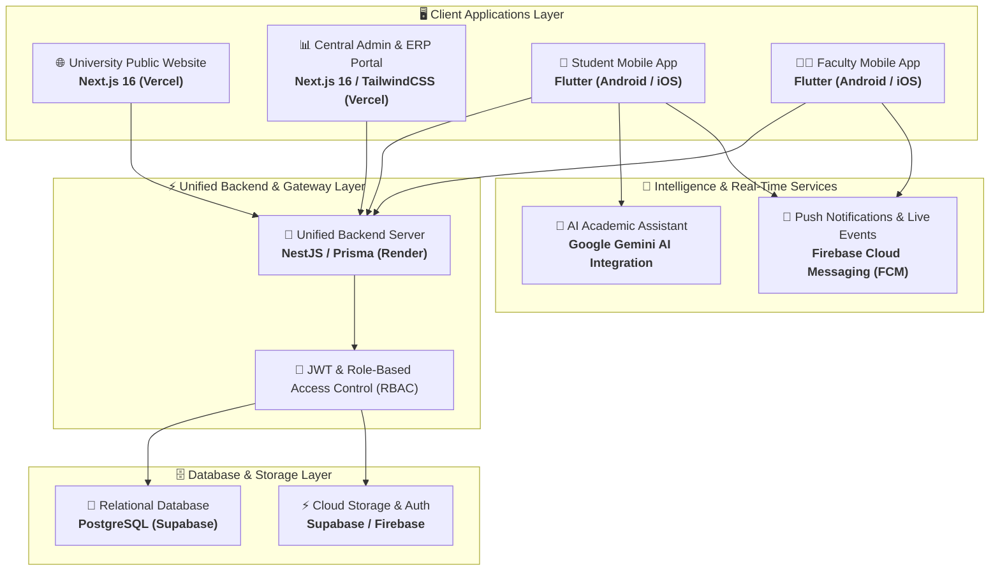
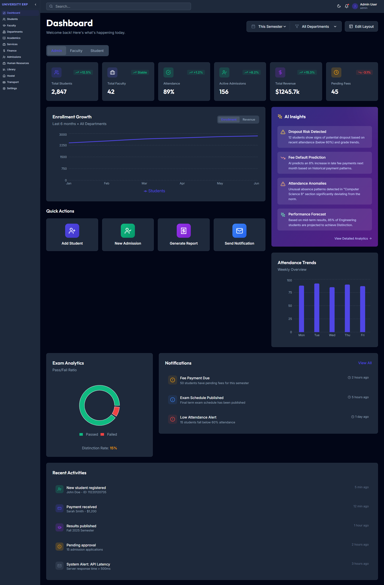
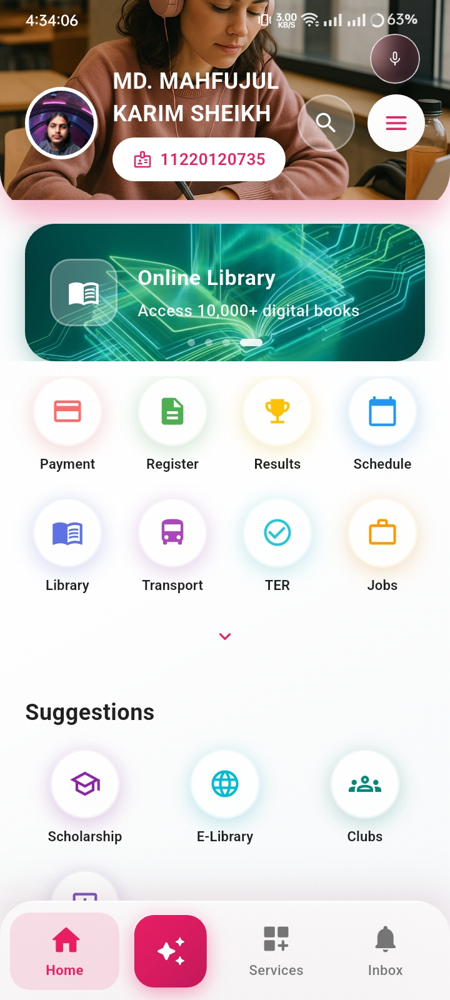
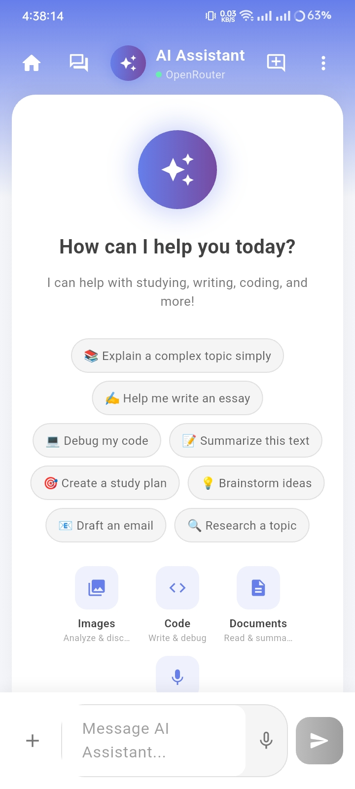
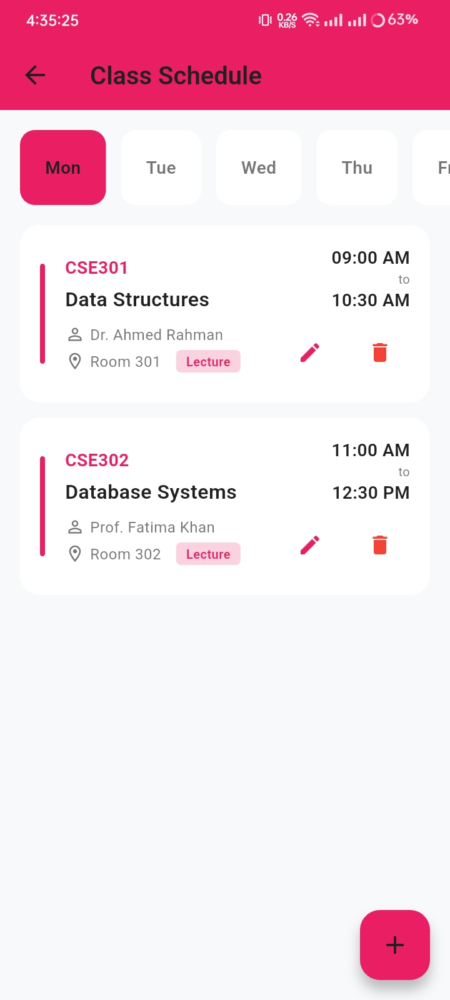
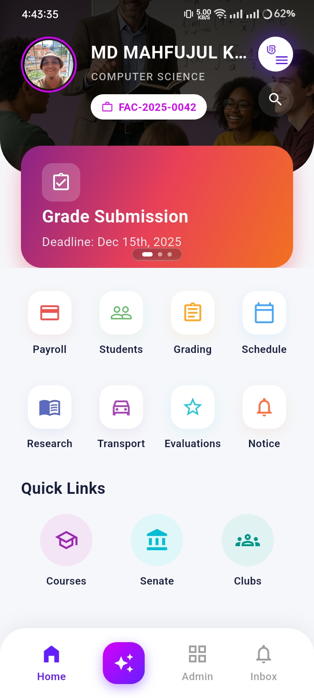
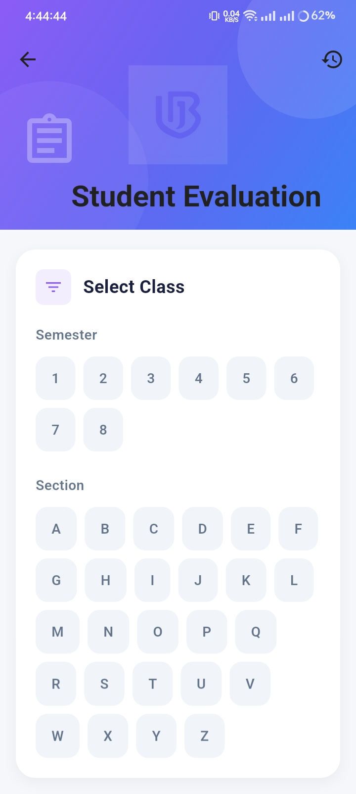
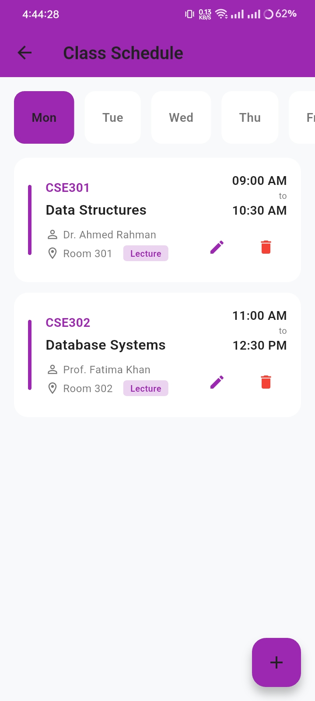

# 🎓 University Management System (NUBTK Automation)
### *A Unified Digital Ecosystem for Academic Excellence & Campus Automation*

 

  <b>Developed for Industrial Training Defense</b> 
  Department of Computer Science & Engineering (CSE) 
  <b>Northern University of Business and Technology Khulna (NUBTK)</b>

[🚀 Live Demo & APKs](#-live-deployments--mobile-apks) •
[📘 Final Project Report (PDF)](#-project-documentation--defense-artifacts) •
[📊 Defense Slides](#-project-documentation--defense-artifacts) •
[🏛️ System Architecture](#-system-architecture) •
[🌐 Web Portals](#-web-portals) •
[📊 Admin ERP](#-centralized-admin-panel--erp) •
[📱 Mobile Apps](#-mobile-applications-flutter) •
[⚡ Key Features](#-key-features--capabilities)

---

## 🚀 Live Deployments & Mobile APKs

Explore the live prototype deployments and installable Android APK builds directly from the links below:

| Module | Stack & Hosting | Live Link / Download | Notes |
| :--- | :--- | :--- | :--- |
| **🌐 Public University Website** | Next.js 16 · Tailwind CSS · Vercel | **[nubtk-website.vercel.app](https://nubtk-website.vercel.app)** | Public portal, academic info, student & admission portals |
| **📊 Central Admin & ERP Panel** | Next.js 16 · Zustand · Vercel | **[nubtk-admin.vercel.app](https://nubtk-admin.vercel.app)** | Includes **Continue with Demo Admin (Prototype)** & live backend login |
| **⚡ Unified Backend API** | NestJS 10 · Prisma · Render + Supabase | **[nubtk-unified-server.onrender.com](https://nubtk-unified-server.onrender.com)** | REST API prefix `/api` · Free tier may take ~30–50s on initial cold start |
| **📱 Student Mobile App (Android)** | Flutter · Dart · GitHub Release `v1.0.0` | **[Download Student APK (`78.9 MB`)](https://github.com/mahfuj735/nubtk_automation/releases/download/v1.0.0/NUBTK-Student-App-v1.0.0.apk)** | Release APK (`app-release.apk`) ready for direct Android installation |
| **👨‍🏫 Faculty Mobile App (Android)** | Flutter · Dart · GitHub Release `v1.0.0` | **[Download Faculty APK (`63.6 MB`)](https://github.com/mahfuj735/nubtk_automation/releases/download/v1.0.0/NUBTK-Faculty-App-v1.0.0.apk)** | Release APK (`app-release.apk`) ready for direct Android installation |

> 📦 **All Release Assets:** Available under [**Releases (`v1.0.0`)**](https://github.com/mahfuj735/nubtk_automation/releases/tag/v1.0.0).

---

## 📚 Project Documentation & Defense Artifacts

The repository includes both the complete **44-Page Academic Final Project Report** and the **Industrial Training Defense Presentation Slides**:

<table align="center" width="100%">
  <tr>
    <td align="center" width="48%" valign="top">
      <h3>📘 Comprehensive Final Project Report</h3>
      
<b>44 Pages • Complete Academic Monograph</b>

      
        
      
        
      

        <b>Key Highlights:</b> Formal academic monograph covering requirement engineering, relational schemas (10+ tables), system architecture, implementation phases, benchmarking & latency test data, and user experience analysis.
      

    </td>
    <td align="center" width="52%" valign="top">
      <h3>📊 Defense Presentation Slide Deck</h3>
      
<b>15 Slides • Defense Visuals & Summary</b>

      
        
      
      &nbsp;
      
        
      

        <b>Key Highlights:</b> Slide deck utilized during the official industrial training defense examination before the departmental board at NUBTK. Summarizes system motivation, core modules, architecture, and live demo results.
      

    </td>
  </tr>
</table>

 

### 📑 Project Report Outline & Chapter Guide

For an in-depth understanding, the complete project report ([Final_project_Report.pdf](./Final_project_Report.pdf)) is structured into the following chapters:

| Chapter | Title | Key Contents & Detailed Coverage |
| :---: | :--- | :--- |
| **Chapter 1** | **Introduction & Scope** | Motivation behind campus automation, primary objectives, specific technical aims, academic learning outcomes, and report organization. |
| **Chapter 2** | **Literature Review & Gap Analysis** | Digital transformation in tertiary education, ERP paradigms, comparative review against Canvas LMS and Moodle, identification of system gaps, and technology selection rationale. |
| **Chapter 3** | **System Methodology & Architecture** | Modular MVC architecture, route map, comprehensive database schema design (Users, Students, Admissions, Courses, Evaluations, Badges, Transport, etc.), 7-phase implementation process, and key algorithms (admission pipeline, CGPA engine, data sync, and AI query router). |
| **Chapter 4** | **Results, Discussion & Benchmarks** | Detailed walkthrough of the public portal, admission system, central admin ERP, Flutter mobile apps, database query latency tests, system accuracy benchmarks, security hardening, and user satisfaction metrics. |
| **Chapter 5** | **Conclusions & Recommendations** | Summary of industrial training achievements, real-world deployment challenges, project limitations, and future roadmap (e.g., MFS automated payment integration). |

 

| Academic Details | Information |
| :--- | :--- |
| **Project Title** | University Management System: A Digital Ecosystem for Academic Excellence |
| **Course** | **CSE 4100: Field Work / Industrial Training** |
| **Presented By** | **Md. Mahfujul Karim Sheikh** (Student ID: `11220120735`, Section: `7B`, 7th Semester) |
| **Supervised By** | **Md. Mossadek Touhid**, Lecturer, Department of CSE |
| **Institution** | **Northern University of Business and Technology Khulna (NUBTK)** |
| **Academic Session** | January, 2026 |
| **Core Focus** | End-to-end digitisation of academic, administrative, financial, and student workflows |

---

## 💡 Problem Statement & Objective

Traditional university operations rely heavily on manual paperwork, distributed spreadsheets, and disconnected desktop systems. This causes:
- ⏳ **Slow Administrative Turnaround:** Admission, course registration, and document clearance take days or weeks.
- 📉 **Data Redundancy & Errors:** Inconsistent student records across separate departments.
- 🔕 **Communication Gap:** Delays in routine changes, examination schedules, and urgent notifications reaching students.
- 📊 **Lack of Centralized Analytics:** University leadership lacks real-time insight into attendance, fee defaults, and student performance.

### 🎯 The Solution:
**NUBTK Automation** delivers a single, unified digital platform connecting **students, faculty members, and central administration**. It bridges public-facing information portals with deep administrative automation and native mobile apps equipped with an AI-powered academic assistant.

---

## 🏛️ System Architecture

---

## 🌐 Web Portals

> 🔗 **Live Public Portal:** **[https://nubtk-website.vercel.app](https://nubtk-website.vercel.app)**

### 1. University Public Portal
Modern, responsive web interface for prospective students, current students, faculty, and public visitors.
- Academic regulations, program curriculums, and departmental information.
- Campus virtual tour, event calendars, and official notices.

  

 

### 2. Online Admission & Application Pipeline
- Fully digital admission application submission.
- Real-time document verification and applicant tracking.

  

---

## 📊 Centralized Admin Panel & ERP

> 🔗 **Live Admin Panel:** **[https://nubtk-admin.vercel.app](https://nubtk-admin.vercel.app)** *(Supports one-click **Demo Admin** prototype preview as well as live backend authentication)*

The admin dashboard provides full institutional command with predictive business intelligence:
- **Real-Time KPIs:** Live counts of active students (2,800+), faculty members, overall attendance rate, and revenue collection.
- **Workflow Pipeline:** Step-by-step verification (Payment Verified ➔ Documents Verified ➔ Interview Scheduled ➔ Final Approval).
- **AI-Driven Insights:** Automated detection of student dropout risks, fee default predictions, and attendance anomalies.

  

---

## 📱 Mobile Applications (Flutter)

Cross-platform mobile applications tailored specifically for student and faculty daily routines:

### 🎓 Student Mobile App
Equipped with personal profiles, academic tracking, tuition fee payments, dynamic class schedules, and a generative AI study assistant.

> 📥 **[Download Student App APK (v1.0.0 · 78.9 MB)](https://github.com/mahfuj735/nubtk_automation/releases/download/v1.0.0/NUBTK-Student-App-v1.0.0.apk)**

<table align="center" width="100%">
  <tr>
    <td align="center" width="33%">
      
        
      <b>🏠 Student Dashboard</b> 
      Online Library, Payment, Course Registration & Results
    </td>
    <td align="center" width="33%">
      
        
      <b>🤖 AI Academic Assistant</b> 
      24/7 AI tutor for syllabus queries, code debugging & concept explanations
    </td>
    <td align="center" width="33%">
      
        
      <b>📅 Dynamic Class Routine</b> 
      Day-by-day lecture timing, room assignments & instructor info
    </td>
  </tr>
</table>

 

### 👨‍🏫 Faculty Mobile App
Empowers professors and course instructors with on-the-go academic management.

> 📥 **[Download Faculty App APK (v1.0.0 · 63.6 MB)](https://github.com/mahfuj735/nubtk_automation/releases/download/v1.0.0/NUBTK-Faculty-App-v1.0.0.apk)**

<table align="center" width="100%">
  <tr>
    <td align="center" width="33%">
      
        
      <b>📋 Faculty Command Center</b> 
      Grade submission deadlines, course allocation, payroll & notices
    </td>
    <td align="center" width="33%">
      
        
      <b>📝 Student Evaluation & Grading</b> 
      Semester & section-wise marks entry, assessment & grading
    </td>
    <td align="center" width="33%">
      
        
      <b>🕒 Teaching Timetable</b> 
      Direct overview of daily assigned lecture hours and halls
    </td>
  </tr>
</table>

---

## ⚡ Key Features & Capabilities

- 🔐 **Enterprise Security & RBAC:**
  Role-Based Access Control enforcing strict separation of privileges across Superadmin, Department Head, Faculty, and Student tiers. Powered by stateless JWT token rotation.
- 🤖 **AI-Powered Academic Assistant:**
  Integrated with modern LLM intelligence to help students understand complex lecture topics, draft academic queries, review code, and receive tailored course assistance.
- 🚀 **Streamlined Digital Admission:**
  Paperless applicant verification workflow featuring online fee reconciliation and automated admission status alerts.
- 📲 **Real-Time Notification Broadcast:**
  Firebase Cloud Messaging (FCM) delivers instant emergency announcements, class rescheduling notices, and grade releases directly to mobile devices.
- 🛡️ **Data Sanitization & Injection Defense:**
  All REST endpoints incorporate schema validation, SQL injection prevention, and encrypted data storage for sensitive records.

---

## 📈 Measurable Results & Impact

| Metric | Improvement | Description |
| :---: | :---: | :--- |
| 📉 **70%** | **Manual Workload Reduction** | Drastic cut in physical paperwork and manual ledger maintenance. |
| ⚡ **80%** | **Faster Processing** | Admission cycle time reduced from weeks of physical queues to digital minutes. |
| 🎯 **95%** | **Data Accuracy Improvement** | Elimination of duplicate records and manual grade transcript errors. |
| 🌐 **99.5%** | **System Reliability** | High availability with decoupled micro-services and cloud failover. |

---

## 🛠️ Technology Stack Summary

| Domain | Technologies Used |
| :--- | :--- |
| **Mobile Applications** | Flutter, Dart, Riverpod / Provider |
| **Web Frontends** | Next.js 16, React 19, TypeScript, TailwindCSS, Zustand |
| **Backend Services** | NestJS 10, Prisma ORM, Express.js, TypeScript |
| **Databases** | PostgreSQL (Supabase Cloud) |
| **Cloud & Hosting** | Vercel (Frontends), Render (Backend API), Firebase (Auth, FCM) |
| **AI Integration** | Google Gemini API for Academic Assistant |

---

## 🚀 Future Roadmap

- [ ] **MFS & Payment Gateway:** Integration of bKash, Nagad, and Credit/Debit card automated payment reconciliations.
- [ ] **Parent & Alumni Portals:** Dedicated portals for parent progress tracking and alumni networking.
- [ ] **Automated Exam Hall Seating:** Algorithmic examination seat plan generator to avoid section clustering.
- [ ] **Multi-Region Cloud Deployment:** Geographic redundancy and auto-scaling infrastructure.

---

## 👤 Author & Acknowledgements

- **Developer:** Md. Mahfujul Karim Sheikh
  - Student ID: `11220120735`
  - Section: `7B`, 7th Semester
  - Department of Computer Science & Engineering (CSE)
  - Northern University of Business and Technology Khulna (NUBTK)
- **Academic Supervisor:** Md. Mossadek Touhid
  - Lecturer, Department of CSE, NUBTK
- **Academic Documents:**
  - 📘 **Full Project Report:** [Final_project_Report.pdf](./Final_project_Report.pdf) *(44-page formal thesis monograph)*
  - 📊 **Defense Presentation Slides:** [Mahfuj735.pptx](./Mahfuj735.pptx) • [Mahfuj735.pdf](./Mahfuj735.pdf)

---

  © 2026 Northern University of Business & Technology Khulna. All rights reserved.

